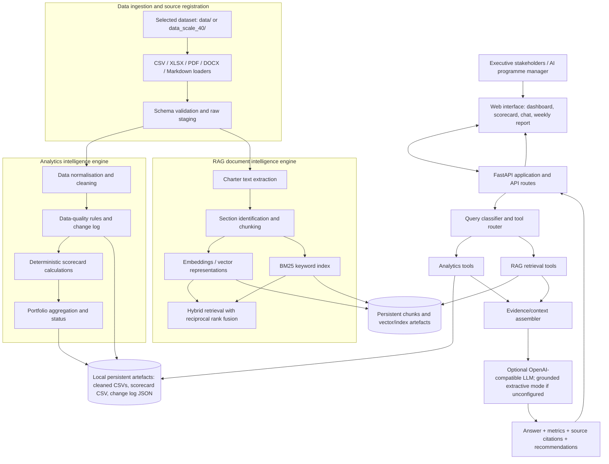

# High-Level Design — Nimbus Group Enterprise RAG Value Intelligence Assistant

## Logical architecture

## End-to-end flow

1. An administrator selects `nimbus_8` (8 curated initiatives) or `nimbus_40` (40 initiatives; includes the original 8 plus 32 generated initiatives). The directories are never concatenated.
2. Ingestion reads the selected raw CSV, XLSX and charter files. It records source filenames and does not load answer keys into production processing.
3. The analytics branch normalises identifiers, dates, numeric formats, metric aliases and financial measures; removes exact duplicate usage rows; logs missing weeks and invalid observations; aggregates monthly cost rows; excludes precomputed ROI; and writes a detailed change log.
4. Deterministic Python code computes initiative scorecards and portfolio aggregates using the documented HCL definitions.
5. The RAG branch extracts Markdown, PDF and DOCX text; identifies sections; chunks content; creates embeddings (Sentence Transformers when installed, otherwise TF-IDF vectors); maintains a BM25 index; and retrieves with reciprocal rank fusion.
6. The query router sends numerical questions to scorecard logic, narrative questions to charter retrieval, and hybrid questions to both.
7. The response layer uses only verified scorecard values and retrieved charter evidence. The optional LLM can explain evidence but is not permitted to calculate figures or obey instructions embedded in charter text.
8. The web app exposes the scorecard, sources, change log, grounded assistant and weekly executive report.
9. Offline evaluation compares results against the supplied answer keys and runs no-answer, personal-data and prompt-injection checks.

## Deployment architecture

The included prototype runs as one FastAPI service serving a static web UI. It persists derived files and retrieval artefacts under `storage/`; it does not require a separate database server for the supplied practice datasets. This keeps the hackathon setup simple and reproducible. The logical components can later be separated into a Next.js frontend, FastAPI backend, PostgreSQL and a managed vector store without changing the HCL functional behaviour.
